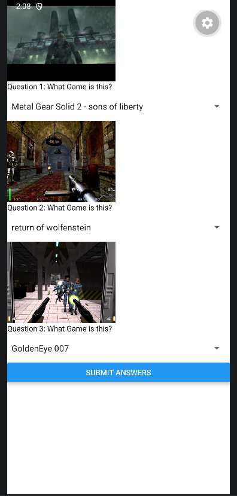
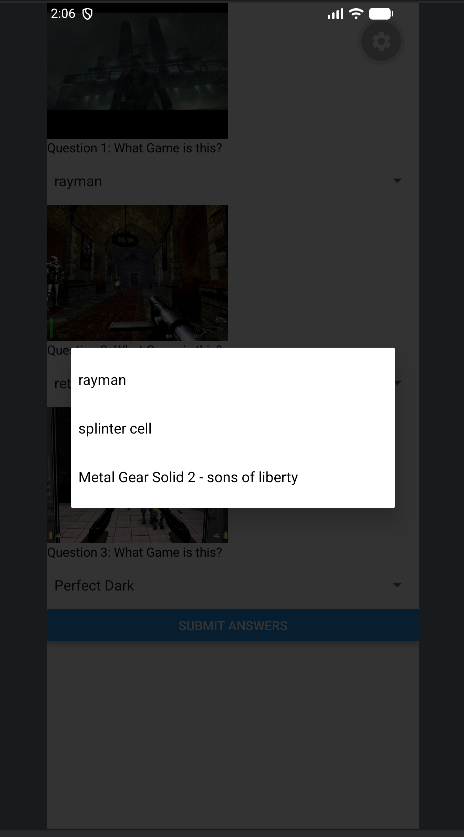
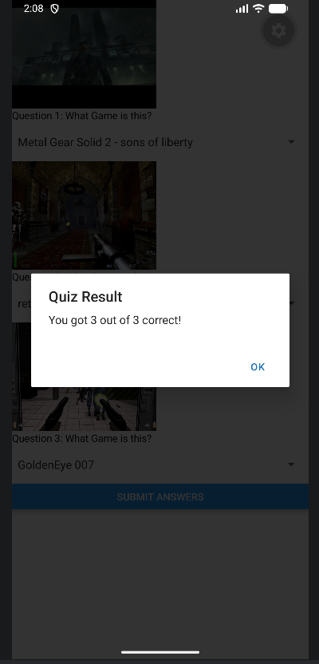
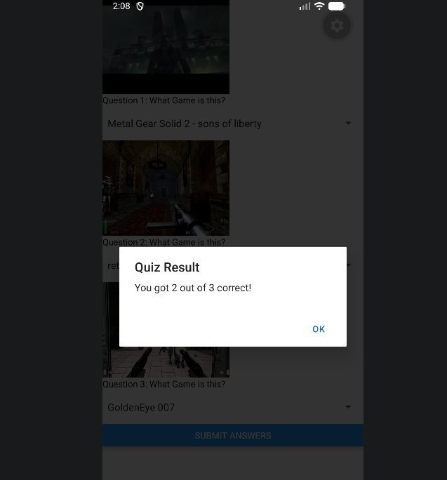

# App Name

A brief description of the mobile application and its purpose.
Retro Games Quiz

A simple React Native quiz application that allows users to identify retro video games from screenshots. Users select answers from a dropdown list and submit their responses to receive a score.
# Features Highlight

Highlight the features of your app and describe the concepts applied
Display game screenshots using Image component.
Select answers using Picker dropdown menus.
Store user selections using React State (useState).
Calculate score based on correct answers.
Display results using Alert.
Uses React Native components such as View, Text, Image, Button, and Picker.
# ScreenShots of App

Screenshots:  

# Demo Video

Demo Video Link:  